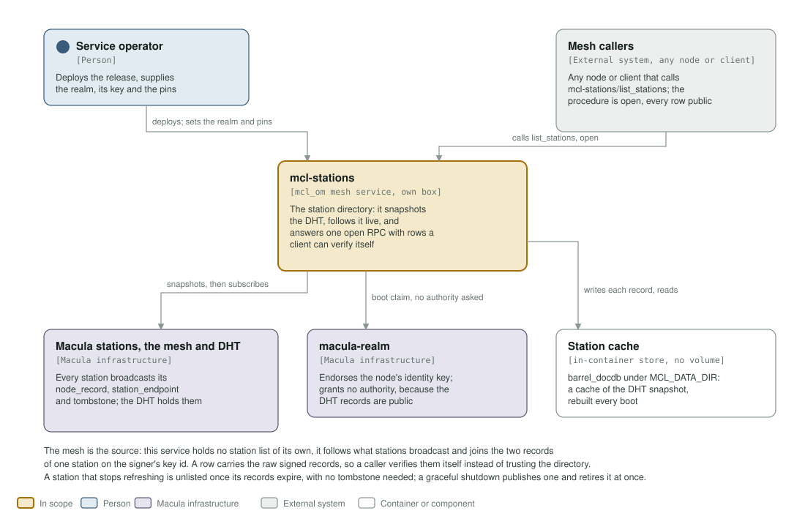
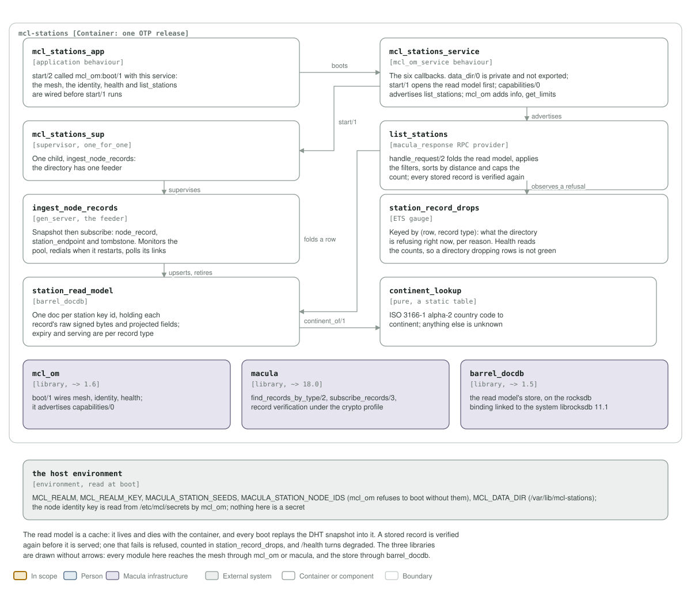

# mcl-stations architecture: C4 model

*This exists so a reader can see what mcl-stations talks to, and what it is made
of, without reading it.*

**Status: 0.4.1, serving `list_stations`.** The service boots, joins the mesh,
snapshots the DHT's station records, follows them live, and answers one open RPC
from a `barrel_docdb` read model. It asks the realm for no authority, keeps no
event store, and stores no station list of its own.

## Level 1: system context

| Element | Kind | Role |
| --- | --- | --- |
| mcl-stations | In scope | One OTP release in one container, an `mcl_om` mesh service on its own box. Answers `mcl-stations/list_stations` from the directory it builds out of the DHT |
| Service operator | Person | Deploys the release and supplies the realm, its key and the pinned station seeds |
| Mesh callers | External system, any node or client | Any node or client that calls `mcl-stations/list_stations`. The procedure is open, because every row in the reply is public already |
| Macula stations, the mesh and DHT | Macula infrastructure | Every station broadcasts its `node_record` (0x01), `station_endpoint` (0x12) and `tombstone` (0x0C); the DHT holds them and this service only reads |
| macula-realm | Macula infrastructure | Endorses the node's identity key and grants no authority: the records live in the DHT's own realm, and serving an RPC needs no realm-granted topic |
| Station cache | External system, host directory | `barrel_docdb` under `MCL_DATA_DIR` (`/var/lib/mcl-stations`), a cache of the DHT snapshot with no volume, rebuilt every boot |

The mesh is the source. The service holds no station list of its own: it follows
what stations broadcast and joins the two records of one station on the signer's
key id. A row carries the raw signed records, so a caller verifies them itself
instead of trusting this directory. A station that stops refreshing is unlisted
once its records expire, with no tombstone needed; a graceful shutdown publishes
one and retires it at once.

## Level 2: containers and components

| Component | Technology | Responsibility |
| --- | --- | --- |
| `mcl_stations_app` | application behaviour | `start/2` is `mcl_om:boot(mcl_stations_service)`: the mesh, the identity, health and the capability are wired before `start/1` runs |
| `mcl_stations_service` | the `mcl_om_service` behaviour | The six callbacks plus `data_dir/0`. `start/1` opens the read model first; `capabilities/0` advertises `list_stations` with `auth => open`; `health/0` turns degraded on a lost subscription, a pool with no live link, or any refused record |
| `mcl_stations_sup` | supervisor, `one_for_one` | One child, `ingest_node_records`: the directory has one feeder |
| `ingest_node_records` | `gen_server`, the feeder | Snapshot then subscribe over `node_record`, `station_endpoint` and `tombstone`. Monitors the pool, redials when it restarts, and polls `macula_client:status/1` for a live link |
| `list_stations` | `macula_response` RPC provider | `handle_request/2` folds the read model, applies `continent`/`country`/`city`/`near`/`limit`, sorts by great-circle distance and caps the count. Every stored record is verified again before it is served |
| `station_read_model` | `barrel_docdb` | One doc per station key id, holding each record's raw signed bytes and projected fields. Expiry and serving are per record type, so a lapsed `node_record` drops its fields while a live endpoint keeps the station listed |
| `station_record_drops` | ETS gauge | Keyed by (row, record type): what the directory is refusing right now, per reason. Health reads the counts, so a directory quietly dropping rows is degraded, never green |
| `continent_lookup` | pure, a static table | ISO 3166-1 alpha-2 country code to continent; anything else is `unknown` |
| `mcl_om` | library, `~> 1.0` | `boot/1` wires the mesh, identity and health, and registers the advertised capability |
| `macula` | library, `~> 15.6` | `find_records_by_type/2`, `subscribe_records/3`, and record verification under the node's crypto profile |
| `barrel_docdb` | library, `~> 1.5` | The read model's store, on the rocksdb binding linked to the system `librocksdb` 11.1. The image pair carries it at run time |
| the host environment | environment, read at boot | `MCL_REALM`, `MCL_REALM_KEY`, `MACULA_STATION_SEEDS`, `MACULA_STATION_NODE_IDS` (mcl_om refuses to boot without them) and `MCL_DATA_DIR`; the node identity key is read from `/etc/mcl/secrets` by `mcl_om` |

The read model is a cache. It lives and dies with the container, and every boot
replays the DHT snapshot into it, which is why the compose file mounts no volume
for it: a volume would only carry stale rows from before a restart.

## Drawing them

`assets/c4-context.svg` and `assets/c4-components.svg` are generated by
`architecture/c4_diagrams.py` (`python3 architecture/c4_diagrams.py`), from the
code and never from this page: the callbacks and the capability in
`mcl_stations_service.erl`, the child in `mcl_stations_sup.erl`, the record
types and the snapshot-and-subscribe in `ingest_node_records/`, the provider in
`list_stations/`, `station_read_model.erl`, `station_record_drops.erl`,
`continent_lookup.erl`, the dependencies in `rebar.config`, and the environment
in `config/sys.config.src`, the `Containerfile` and `deploy/docker-compose.yml`.
When one of those changes, the diagram changes in the same commit.

Two rules for the files themselves, so they render everywhere they are read
(GitHub, an IDE, `rsvg-convert`): self-contained SVG, and literal colours in
plain classes plus a `prefers-color-scheme` dark block, never CSS custom
properties, which `rsvg-convert` renders black.

The check that keeps them here is the `c4-model` job in
`.github/workflows/build-push.yml`. It is red until both files exist and are
shown, and it stays red if either one goes missing.
